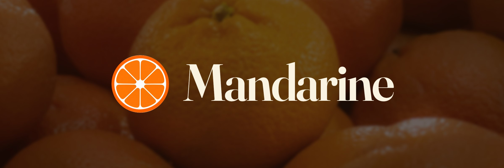
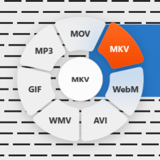
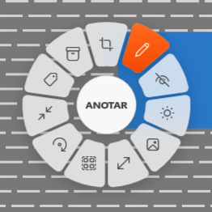
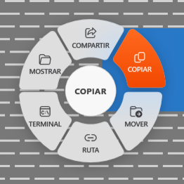

<p align="center"></p>

# Mandarine

**English** · [Español](README.es.md)

Drag a file, tap **Shift**, **Ctrl** or **Alt**, and pick from a wheel. Convert, compress, crop, annotate and share
images, audio, video, PDFs and Office files, offline, on Windows.

<table align="center">
  <tr>
    <th align="center"><kbd>Shift</kbd> · Convert</th>
    <th align="center"><kbd>Ctrl</kbd> · Tools</th>
    <th align="center"><kbd>Alt</kbd> · Actions</th>
  </tr>
  <tr>
    <td></td>
    <td></td>
    <td></td>
  </tr>
</table>

## Download

1. Open [Releases](https://github.com/1iFabi/Mandarine/releases) and download `Mandarine-vX.Y.Z-win-x64.zip`.
2. Unzip it anywhere (for example `C:\Programs\Mandarine`) and run `Mandarine.exe`.
3. A tangerine icon appears in the notification area. That's it: Mandarine waits in the background.

Requirements: Windows 10 (version 2004 or later) or Windows 11, 64-bit. Nothing else to install: .NET and every
converter come inside the zip.

> **"Windows protected your PC"?** The app isn't code-signed yet, so SmartScreen warns about it the first time.
> Click **More info → Run anyway**. You can check the download against the SHA-256 listed in each release.

To start it with Windows, right-click the tray icon and tick **Iniciar con Windows** (start with Windows).

## How to use it

1. Start dragging one or more files (from Explorer, the desktop, a browser download bar...).
2. **Without letting go of the mouse**, tap a key:

   | Key | Wheel | What's on it |
   |---|---|---|
   | **Shift** | Convert | Target formats for the dragged files |
   | **Ctrl** | Tools | Compress, crop, rotate, remove background, OCR... |
   | **Alt** | Actions | Share, copy, move, copy path, terminal, show in folder |

3. Point at an option (the centre shows its name) and release.

Results are saved **next to the original**, never over it (`photo.jpg` → `photo.webp`, or `photo (1).jpg` when the
name is taken). Release over the centre, or press **Esc**, to cancel. Tapping another key mid-drag switches wheels.

Right-click the tray icon for **Rueda oscura** (dark wheel), **Iniciar con Windows** (start with Windows) and **Salir** (exit).

> Mandarine's interface is in Spanish for now; this page uses the English names of the options
> (Crop = *Recortar*, Annotate = *Anotar*, Hide = *Ocultar*, Share = *Compartir*...).

## What it can do

### Convert (Shift)

| From | To |
|---|---|
| Images: JPG, PNG, WebP, HEIC, TIFF, AVIF, BMP | JPG, PNG, WebP, TIFF, AVIF, BMP, PDF (several images → one PDF) |
| Audio: MP3, M4A, AAC, WAV, FLAC, OGG, Opus, AIFF, WMA | MP3, M4A, WAV, FLAC, OGG, Opus, AIFF, WMA |
| Video: MP4, M4V, MOV, MKV, WebM, AVI, WMV, GIF | MP4, MOV, MKV, WebM, AVI, WMV, GIF |
| Documents: DOCX, DOC, ODT, RTF, HTML, Markdown, TeX, TXT | PDF, DOCX, ODT, RTF, MD, HTML, TXT |
| Spreadsheets: XLSX, XLS, ODS, CSV, TSV | PDF (columns fitted to their content), XLSX, CSV, TSV, HTML |
| Presentations: PPTX, PPSX, POTX | PDF, PNG, JPG, GIF, MD, TXT |
| PDF | DOCX, PPTX (one slide per page), PNG / JPG (one image per page), TXT, HTML, RTF |

### Tools (Ctrl)

| For | Tools |
|---|---|
| Images | **Crop**, **Annotate** (arrow, box, pen, highlighter, text), **Hide** (pixelate or black out), **Adjust** (brightness, contrast, saturation, warmth), **Background** (gradient or colour, margin, rounded corners, shadow, canvas ratio), **Resize** (by percentage or exact pixels, keeping the proportion), **Remove background**, **Rotate** (90°, 180° or 270°), Compress, Remove metadata |
| Audio | Normalize loudness, Remove metadata |
| Video | Compress, **Rotate** (90°, 180° or 270°), Remove metadata |
| PDF | **Rotate** (every page or the ones you pick), **Split** (by page ranges), OCR (makes scans searchable; Spanish and English), Compress, Remove metadata, Merge (2+ PDFs) |
| Anything | Make a ZIP (files and folders); on a `.zip`, Extract |

The image editors open a window: the picture on the left, the options on the right, and below them a tab that names
the file about to be written, its size and its folder. **Crop** (drag, or type the area in pixels), **Adjust**,
**Background** and **Resize** are set once and applied to every dragged picture; **Annotate** and **Hide** go one picture
at a time. Enter saves, Esc cancels, Ctrl+Z undoes.

**Rotate** opens a window too, to pick the angle. On a PDF it shows the pages: click the ones to turn (or none, to
turn them all). **Split** shows the pages and, on the right, the parts as page ranges ("from 3 to 7"): type them, click
between two pages to cut there, or use *Cada página* (every page) and *Por la mitad* (in half). One range extracts those
pages into a new PDF; several are saved in a folder beside the original. Resize the pages on the right (or with
Ctrl + wheel) and double-click one to see it large.

### Actions (Alt)

**Share** (Windows share sheet: Nearby Share, Mail...), **Copy** (paste in Explorer), **Move** to a folder,
copy **Path**, open a **Terminal** there, **Show** in Explorer.

### Privacy

Everything runs on your PC. No file, name or usage data ever leaves it: there is no network code in Mandarine.

## How it works

```
 tap Shift/Ctrl/Alt            the wheel appears              you drop on an option
 while the mouse is down  ──►  under the cursor        ──►   Mandarine runs the job
 (keyboard hook)               (asks Catalog what fits)       (Converter → engine)
```

1. **Gesture.** A low-level keyboard hook (`KeyboardHook.cs`) notices a modifier key tapped on its own while the
   left mouse button is held, which only happens mid-drag.
2. **Wheel.** `WheelWindow` captures the screen under the cursor, blurs it into frosted glass (`Backdrop.cs`) and
   shows a ring of options without stealing focus from the app you are dragging from. Motion uses critically damped
   springs (`Spring.cs`) and follows the Windows "Animation effects" setting.
3. **Options.** `Catalog.cs` maps file extensions to what can be done with them: only options valid for *every*
   dragged file are offered, and only if the tool behind them is available.
4. **The job.** `Converter.cs` runs the chosen option with the right engine and writes the result beside the input:

   | Engine | Used for |
   |---|---|
   | [FFmpeg](https://ffmpeg.org) | Images, audio, video, rotate, compress, normalize |
   | [wordcraft](https://github.com/storytold/wordcraft), [gridcraft](https://github.com/storytold/gridcraft), [deckcraft](https://github.com/storytold/deckcraft) | Documents, spreadsheets, presentations |
   | [pdfcraft](https://github.com/storytold/pdfcraft) | Everything PDF except PDF → DOCX |
   | Microsoft Word (if installed) | PDF → DOCX, with a better layout than pdfcraft's fallback |
   | [Tesseract](https://github.com/tesseract-ocr/tesseract) (`Ocr.cs`) | OCR: reads each page and writes an invisible text layer over it |
   | [BiRefNet](https://github.com/ZhengPeng7/BiRefNet) on [ONNX Runtime](https://onnxruntime.ai) (`Background.cs`) | Remove background |
   | Built in (`ImageEdit.cs`, `EditorWindow`, `Metadata.cs`, `Archive.cs`, `Actions.cs`, `Share.cs`) | Picture editors, lossless JPEG/PNG metadata removal, ZIP, file actions, share sheet |

   The external tools are separate programs that Mandarine starts; they live in `tools\` next to the app.

| Path | What's there |
|---|---|
| `src/Mandarine/` | The app (C#, .NET 8, WPF) |
| `tests/Mandarine.Tests/` | xUnit tests: every conversion and tool on real files, plus rendered previews of the wheel and editors |
| `scripts/fetch-tools.ps1` | Downloads the bundled tools at pinned versions, verifying each SHA-256 |
| `scripts/package.ps1` | Builds the release zip |

## Build from source

You need the [.NET 8 SDK](https://dotnet.microsoft.com/download/dotnet/8.0) and Windows PowerShell.

```powershell
git clone https://github.com/1iFabi/Mandarine.git
cd Mandarine
.\scripts\fetch-tools.ps1          # ~580 MB of converters, models and OCR data, into src\Mandarine\tools\
dotnet test tests\Mandarine.Tests  # optional: converts real files with every engine (~30 s)
dotnet run --project src\Mandarine
```

### Make a release

```powershell
.\scripts\package.ps1 -Version 1.0.1
```

It fetches the tools, runs the tests, publishes a self-contained build, checks every tool made it in, and writes
`dist\Mandarine-v1.0.1-win-x64.zip` with its SHA-256. Then publish it, for example with the GitHub CLI:

```powershell
gh release create v1.0.1 dist\Mandarine-v1.0.1-win-x64.zip --title "Mandarine 1.0.1" --notes "SHA-256: <hash>"
```

## Known limitations

- Video and audio trimming or redaction aren't there yet.
- Alt can activate the menu bar of the window under the cursor after the drop.
- OCR reads Spanish and English, ignores page skew, and may drop rare letters such as "ü".
- Remove background takes about 10 seconds per picture on the CPU.
- Edited pictures lose their metadata (EXIF).

## Credits and license

Mandarine is released under the [MIT License](LICENSE). The bundled tools keep their own licenses, listed in
[THIRD-PARTY-NOTICES.md](THIRD-PARTY-NOTICES.md); notably, the bundled FFmpeg build is GPLv3.

Inspired by the workflow of Tangerine for Mac. Mandarine is an independent project with its own code, name and
artwork, and has no relation to Tangerine or its authors.

Banner photo from [Pexels](https://www.pexels.com/photo/30552332/).
